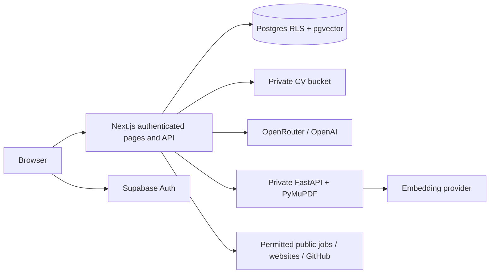

# AI Internship Copilot

A student workspace for understanding CV evidence, finding relevant internships, preparing applications and tracking learning. It preserves original CVs, labels uncertain evidence, and never submits job applications or sends email automatically.

## Current features

| Page | What it does |
| --- | --- |
| `/profile` | Private PDF upload, text extraction and explainable CV quality review |
| `/jobs` | Public internship feeds and hybrid skill/semantic/preference ranking |
| `/companies` | Public company/job research with evidence citations and pgvector retrieval |
| `/github` | Public repository evidence and user-approved skill suggestions |
| `/learning` | Versioned learning roadmaps, tasks, evidence and progress |
| `/applications` | Seven-stage Kanban, dates, notes, history and linked preparation |
| `/tailoring` | Individual review of conservative CV edits and new PDF versions |
| `/dashboard` | Saved assessments, skills, gaps, activity and next actions |

Mock interview scores are not recorded; the dashboard explicitly shows that limitation. Matching scores are recommendation relevance, not hiring probabilities. AI suggestions require human review.

## Stack

Next.js 15 App Router, React 19, TypeScript, Tailwind 4; Supabase Auth/Postgres/private Storage; OpenRouter or OpenAI through the OpenAI SDK and Zod validation; FastAPI embeddings and PyMuPDF editing; Vercel and Render deployment configuration. Node 22 and Python 3.13 are used for validation.

## Start locally

```powershell
npm.cmd ci
npm.cmd run setup:env
```

Fill `.env.local` and `matching-service/.env` using their `.env.example` files. Never commit secrets. Follow [Setup](docs/SETUP.md) to install Python dependencies, apply the supported SQL and configure email confirmation.

```powershell
# Terminal 1
npm.cmd run dev
# Terminal 2
npm.cmd run dev:matching
```

Open the local URL printed by Next.js. For an existing installation, apply the additive [production security migration](supabase/migrations/20261030000000_production_security.sql) before using legacy analyze/match/agent endpoints. No existing application/CV data is deleted by that migration.

## Architecture



## Verification

```powershell
npm.cmd run typecheck
npm.cmd run lint
npm.cmd run test
npm.cmd run build
npm.cmd run check:secrets
npm.cmd run test:e2e
npm.cmd run test:ranking
cd matching-service
.\.venv\Scripts\python.exe -m unittest discover -p "test_*.py"
.\.venv\Scripts\python.exe -m pip check
```

Playwright browser installation: `npx playwright install chromium`. Authenticated E2E requires a dedicated confirmed test account; absent credentials are reported as skips, not passes. [Testing](docs/TESTING.md) lists SQL suites, dependency audits and remaining live checks. [Validation history](docs/VALIDATION.md) reports actual results.

## Portfolio documentation

- [Architecture and trust boundaries](docs/ARCHITECTURE.md)
- [Database ER diagram](docs/DATABASE.md)
- [API reference](docs/API.md)
- [Setup and environment variables](docs/SETUP.md)
- [Testing guide](docs/TESTING.md)
- [Security audit and remaining risks](docs/SECURITY.md)
- [Deployment, monitoring and rollback](docs/DEPLOYMENT.md)
- [Known limitations](docs/LIMITATIONS.md)
- [Demo walkthrough](docs/DEMO.md)

Feature guides: [CV review](docs/CV_ANALYZER_V2.md), [hybrid matching](docs/HYBRID_JOB_MATCHING.md), [RAG](docs/COMPANY_RAG.md), [GitHub](docs/GITHUB_INTELLIGENCE.md), [learning](docs/LEARNING_ROADMAP.md), [tracker](docs/APPLICATION_TRACKER.md), [tailoring](docs/CV_TAILORING.md), [analytics](docs/CAREER_ANALYTICS.md), [PDF editing](docs/PDF_EDITOR.md).

## What I learned

This project demonstrates enforcing ownership in both API queries and RLS, separating evidence from AI advice, validating structured model responses, building bounded tool loops, measuring ranking on labelled examples, preserving document versions, and distinguishing offline test results from production acceptance. Provider responses, user approvals and task completion each have different evidentiary value; the UI keeps those distinctions visible.

Deployment has not been performed by this upgrade. Successful local checks do not certify a hosted project or guarantee factual AI output.

AI features use the [shared Smart Router](docs/SMART_ROUTER.md): local tools need no LLM; compatible outputs share a structured call; dependent stages wait for verified evidence.
