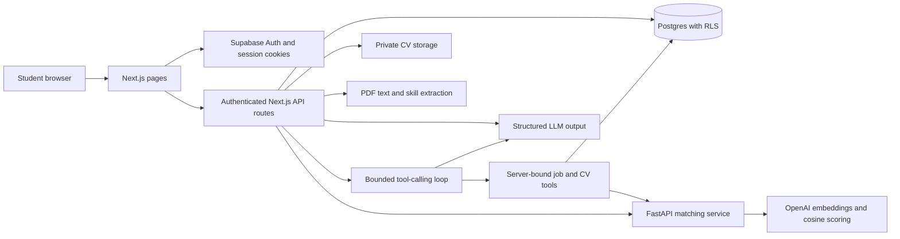

# AI Internship Copilot

A full-stack student application workspace. Paste a job post, upload a CV, compare skill alignment, draft application materials, and track each application.

Implementation for Steps 0–6 is present. Build/lint and offline tests validate code paths; live signup, database/storage ownership, paid AI calls, and deployed acceptance still need your configured accounts. See [step verification](docs/STEPS.md), [progress](docs/PROGRESS.md), and [deployment instructions](docs/DEPLOYMENT.md).

## Features

- `/companies`: private career preferences and company-link shortlisting, source-backed stack/role/pay/work-mode evidence, CV similarity as a percentage and `/10`, grounded CV edits, email draft, learning tasks, project interview practice, and clearly unverified similar-company research leads. See [company research guide](docs/COMPANY_RESEARCH.md).
- Original-layout PDF region editor: select text blocks, queue company-tailored changes, preview fit/layout, download or save a new current CV while retaining the original. See [PDF editor setup and limitations](docs/PDF_EDITOR.md).

- Supabase email/password signup, confirmation resend, login, logout, and protected workspace.
- Application add/list/status update/delete, search, filters, and real status counts.
- `/jobs`: structured job analysis into `{ role, company, skills_required, good_to_have, responsibilities }`, with server validation and save-to-tracker.
- `/profile`: private PDF upload, text extraction, explicit skill extraction, replacement, deletion, and saved text display.
- Separate Python FastAPI embedding matching service with cosine similarity, a 0–100 score, matched skills, and missing skills.
- A real bounded LLM tool-calling loop for `analyze_job`, `get_cv`, `match_score`, `rewrite_bullets`, and `draft_email`.
- **Prepare my application** produces three tailored bullets and a short professional email. Copy buttons, CV/timestamp snapshots, persisted results, score cards, skill chips, loading/error states, and responsive layouts.
- RLS and private storage policies enforce ownership; server endpoints also verify the user and scope all IDs.

## Tech stack

| Layer | Technology |
| --- | --- |
| Web frontend/backend | Next.js 15 App Router, React, TypeScript |
| Styling | Tailwind CSS 4 |
| Auth/database/storage | Supabase Auth, Postgres, private Storage |
| AI | OpenAI SDK, strict JSON Schema outputs, Zod validation, function calling |
| Matching | Python 3.13, FastAPI, OpenAI embeddings, cosine similarity |
| Testing | Node test runner with tsx, Python unittest/FastAPI TestClient |
| Hosting | Vercel for Next.js, Render for FastAPI |

## Architecture



The browser never receives OpenAI or matching-service secrets. Tools receive no arbitrary user IDs: the server binds them to the authenticated user, requested application, and newest CV before any AI call. Job/CV content is untrusted data, not executable instructions. Drafts are shown for review; nothing sends an application email.

## 1. Local setup

Requirements: Node.js 22+, Python 3.11+ (tested with 3.13.1), a Supabase project, and an OpenAI API key with billing/model access.

```powershell
npm.cmd install
npm.cmd run setup:env
```

The setup script preserves existing nonempty values, prepares `.env.local` and `matching-service/.env`, and generates a random matching-service key when none exists. It never prints keys. Add your actual Supabase URL/public key and `OPENAI_API_KEY` to `.env.local`. Also put `OPENAI_API_KEY` in `matching-service/.env`; rerunning setup fills a blank service key from the root config but does not overwrite existing values. The shared matching-service keys must be identical.

Use `npm.cmd` in PowerShell when `npm.ps1` is blocked. In other shells, ordinary `npm` works. Restart the dev server after editing env values. Never commit either env file or put a login email/password in place of the project URL/API key.

## 2. Supabase SQL and Auth

In your Supabase project's SQL Editor, paste and run the entire [supabase/setup.sql](supabase/setup.sql). It creates/upgrades the supported schema without deleting application or CV rows. It includes:

- `applications`: identity/ownership, company, role, status, job text, score, structured job data, match data, agent results, and creation time.
- `cvs`: identity/ownership, private file path/name, extracted text, extracted skills, analysis JSON, and creation time.
- User indexes, authenticated-only RLS, and a private `cvs` PDF bucket limited to 4 MB.

The file can be rerun. It is generated with `npm.cmd run sql` from the supported Step 1–5 migrations. The older `20261020000000_initial_schema.sql` is retained as history; do not run it after setup. Each step's migration can instead be run in order; see `docs/STEPS.md`.

Enable email/password authentication. Set Site URL to `http://localhost:3000` and allow the redirect `http://localhost:3000/api/auth/callback`. Keep email confirmation enabled if you want verified signups. Confirm in the same browser/computer as signup while the local server is running. If the email link opened on a phone, its localhost points to the phone, not your laptop. Use **Resend confirmation email** in the app for an expired link, subject to provider email limits.

## 3. Start both servers

Quick matching-service command from the repository root: `npm.cmd run dev:matching`. Keep it running in its own terminal. It uses port 18000; do not start a second copy on the same port.

Terminal 1:

```powershell
cd matching-service
python -m venv .venv
.venv\Scripts\python.exe -m pip install -r requirements.txt
.venv\Scripts\python.exe -m uvicorn main:app --host 127.0.0.1 --port 18000 --reload
```

Terminal 2, from the repository root:

```powershell
npm.cmd run dev
```

Open `http://localhost:3000/signup`. After confirmation/login, upload a CV at `/profile`, analyze a job at `/jobs`, save it, and prepare it at `/dashboard`. `/applications`, `/cvs`, and `/analyze` redirect to the current pages. `/api/analyze` aliases the new `{ job_text }` contract.

The development server uses `.next-dev`; production builds use `.next`, so building does not corrupt a running dev server. If a port is busy, stop the duplicate server or update the Supabase redirect URLs to match the port actually used. Production preview: `npm.cmd run build`, then `npm.cmd start`.

For the company/PDF extension, rerun `supabase/setup.sql`, install the updated matching-service requirements into `matching-service/.venv`, and restart `npm.cmd run dev:matching`. The launcher prefers that environment. The company page is `/companies`; PDF editors are linked from `/profile` and saved company reports. New tables `career_preferences` and `company_reports` have private ownership RLS.

## Environment variables

| Variable | Where | Purpose |
| --- | --- | --- |
| `NEXT_PUBLIC_SUPABASE_URL` | Next.js | Full project API URL copied from Supabase Connect |
| `NEXT_PUBLIC_SUPABASE_ANON_KEY` | Next.js | Public anon/publishable key, never a service-role/secret key |
| `OPENAI_API_KEY` | Next.js and FastAPI | Private key for LLM output and embeddings |
| `OPENAI_MODEL` | Next.js | Defaults to `gpt-4o-mini`; must support strict output and tools |
| `MATCHING_SERVICE_URL` | Next.js | `http://127.0.0.1:18000` locally; Render HTTPS origin in production |
| `MATCHING_SERVICE_API_KEY` | Both servers | Same random private service key; sent in `X-API-Key` |
| `EMBEDDING_MODEL` | FastAPI | Defaults to `text-embedding-3-small` |
| `MATCH_THRESHOLD` | FastAPI | Similarity threshold, default `0.65` |

Root `.env.example` and `matching-service/.env.example` contain names/defaults only. No service-role key is required. A malformed project URL is detected before SDK initialization and displays a setup message instead of crashing middleware.

## API routes

| Route | Method | Input / purpose |
| --- | --- | --- |
| `/api/applications` | GET / POST / PATCH / DELETE | List/create, `{id,status}` update, `?id=` delete |
| `/api/analyze-job` | POST | `{job_text}` → validated job JSON |
| `/api/cvs` | GET / POST | List owned CVs; multipart `file`, optional `replace_id` |
| `/api/cvs/delete` | POST | `{id}` → remove owned row/file |
| `/api/match` | POST | `{application_id}` → match using newest owned CV; persist score/result |
| `/api/agent` | POST | `{application_id}` → tool loop; persist preparation |
| `/api/auth/callback` | GET | Exchange email confirmation code for session cookies |
| FastAPI `/match` | POST | `{cv_text,cv_skills,job_skills}` + private service key |
| FastAPI `/health` | GET | Service readiness |

All private Next.js endpoints authenticate before validating/processing user files or making paid calls. Results are saved only after successful provider output validation. A failed agent run keeps any earlier preparation intact.

## Matching and agent behavior

The service embeds job skills plus CV skills and overlapping 600-character text chunks. Each job skill uses its highest CV cosine similarity; exact skill names count as 1. The score is the rounded mean similarity × 100, and skills below `MATCH_THRESHOLD` are missing. Required skills are used when present, otherwise good-to-have skills. No skill requirements yields an error rather than a fabricated score.

This is an explainable heuristic, not a calibrated hiring probability. The initial skill extractor uses a small explicit vocabulary; full CV text is still embedded. The hosted embedding design keeps FastAPI lightweight and avoids downloading a large local ML runtime.

The agent exposes only prerequisite-ready tools, executes their calls, appends each result using its `tool_call_id`, and requests the next model turn. It requires all five tools before accepting a final answer and stops after eight turns. Saved scores/bullets/emails come from validated tool outputs, not invented final prose. Drafts must be checked for accuracy; bracketed placeholders may appear when the CV has insufficient evidence for three distinct bullets.

## How to test each step

| Step | Acceptance test |
| --- | --- |
| 0 | Run dev; `/login` and `/signup` render. Build/lint succeed. |
| 1 | Signup/confirm/login; add application; change status; refresh; log out/in; delete. Second account sees only its rows. |
| 2 | Paste a job at `/jobs`; inspect clean JSON fields; save and refresh dashboard. Short input and provider errors show readable messages. |
| 3 | Upload a text-based PDF at `/profile`; inspect text/skills; refresh; replace and delete. Another account cannot access it. |
| 4 | Start FastAPI; run Check CV match; inspect score/missing skills; refresh. Missing service key fails safely. |
| 5 | Prepare my application; inspect score, exactly three bullets, email, copy controls, and persisted results. Foreign application IDs return 404 before AI calls. |
| 6 | Test a narrow mobile viewport, keyboard focus, search/filter, loading/errors, and deployed callbacks/ownership using the deployment checklist. |

```powershell
npm.cmd test
npm.cmd run lint
npm.cmd run typecheck
npm.cmd run build
cd matching-service
.venv\Scripts\python.exe -m unittest -v
```

TypeScript tests use fake tool/provider responses; FastAPI tests mock embeddings. They test validation, tool execution order and limits, data isolation, error handling, and scoring without paid calls. They do not prove email delivery, real RLS enforcement, model quality, or deployed persistence. Perform the two-account live tests above.

## Deployment

Follow [docs/DEPLOYMENT.md](docs/DEPLOYMENT.md) for exact Supabase, Vercel, and Render settings. `render.yaml` is included for the Python service. No account provisioning, Git push, or hosting deployment has been performed automatically. Redeploy Vercel when public env values change. The agent requests a 300-second Node function duration; check that this is enabled on your hosting account.

## What I learned

This project provides practice with:

- App Router server/client boundaries and cookie-based authentication.
- RLS as database-level ownership enforcement, alongside server-side ID checks.
- Coordinating file storage and database writes during upload/replacement.
- Treating LLM output as untrusted input: strict JSON Schema plus runtime validation.
- The full tool-calling cycle rather than a single prompted response.
- Embeddings, cosine similarity, and the limits of heuristic scores.
- Testing failure modes with fake providers and deploying two services with shared configuration.

## Known limitations

If analysis reports **OpenAI rejected the API key**, the provider returned an authentication error. Replace `OPENAI_API_KEY` with an active key from your OpenAI API project in both `.env.local` and `matching-service/.env`, then restart both servers. A Supabase key or ChatGPT login/password cannot authenticate OpenAI API requests. Error messages distinguish invalid keys, model access, rate limits, and exhausted credits without displaying provider key fragments.

- Live AI requires a valid API key, model access, billing/quota, and outbound network access; embeddings also incur provider usage. Hosting/email plan limits and cold starts can delay or reject requests.
- PDFs are limited to 4 MB and 50,000 extracted characters. Scanned/image-only or encrypted PDFs need OCR/unlocking outside this app.
- The newest CV is used; no CV selector or automatic regeneration after replacement. Saved drafts identify their CV and creation time; re-run preparation after changes. Historical CV content may remain in saved application drafts until you delete those applications.
- Database and Storage are separate operations. Failed replacement cleanup keeps the new CV and warns about the old entry; a failed compensating cleanup can require manual removal of an orphaned file.
- Model instructions reduce hallucinations but cannot guarantee factual output or prevent every prompt-injection effect on draft wording. Review all claims, names, metrics, and placeholders before use.
- A single synchronous agent request can time out. There is no durable background queue, resumable preparation, per-user paid-call quota, or distributed concurrency lock. Before a public launch, add persistent rate limits and spending controls appropriate to your audience.
- No automatic applications or outgoing application email. No guarantee of interviews, offers, or ATS results.

## References

Implementation uses the official [Supabase SSR guide](https://supabase.com/docs/guides/auth/server-side/creating-a-client), [RLS documentation](https://supabase.com/docs/guides/database/postgres/row-level-security), [OpenAI structured outputs](https://developers.openai.com/api/docs/guides/structured-outputs), [function calling](https://developers.openai.com/api/docs/guides/function-calling), and [embeddings guide](https://developers.openai.com/api/docs/guides/embeddings). Deployment sources are linked in the deployment guide.

## OpenRouter setup

The current local configuration selects OpenRouter. Put `OPENROUTER_API_KEY` in both `.env.local` and `matching-service/.env`; never put a real key in the example files. Both services need `AI_PROVIDER=openrouter`. Next.js uses `OPENROUTER_MODEL=openai/gpt-4.1-mini`; Python uses `OPENROUTER_EMBEDDING_MODEL=openai/text-embedding-3-small`. Restart both services after saving. These are paid OpenRouter models; OpenRouter credits/key limits apply independently of your OpenAI balance.

Run `npm.cmd run dev` and, in another terminal, `npm.cmd run dev:matching`. Test job JSON at `/jobs`, matching with a saved CV/job, then the dashboard agent and `/companies`. Requests require schema/tool-compatible endpoints and still validate returned JSON. No direct OpenAI fallback is made if OpenRouter fails. To select direct OpenAI instead, set `AI_PROVIDER=openai` in both environments and supply the existing OpenAI settings.

On Vercel configure the same web variables; on Render configure the Python variables and shared matching key. See [OpenRouter structured outputs](https://openrouter.ai/docs/guides/features/structured-outputs) and [embeddings](https://openrouter.ai/docs/api/reference/embeddings).

## CV-first onboarding and quality review

The home page, successful login and email callback now open `/profile`. Upload a PDF to save it and automatically request a CV quality review. Existing CVs have an **Analyze CV** button. Five criteria (clarity, relevance, evidence, completeness, writing) are scored 0?2 each; the server calculates the total out of 10 and shows strengths and prioritized recommendations. This is a text-based AI estimate, not a job-match score, ATS certification or hiring prediction.

Reviews are saved in the existing `cvs.analysis.cv_review` JSON field under owner RLS, so no new SQL is needed. Refresh reuses the saved review. Provider failures leave the CV saved with an actionable retry button. Uploading/replacing with an updated CV creates a fresh review; edited PDF copies can be reviewed from the profile. Review requires the configured AI provider key and credits.

Test: log in and verify `/profile`; upload a text PDF; confirm the five sub-scores sum to the displayed /10 rating, strengths and recommendations appear; refresh and check persistence. With no AI credits, verify the CV still saves and the review shows a retry error. Check an older CV's Analyze button and use Applications navigation to reach the tracker.

## Free public job discovery

`/jobs` now starts with a CV-based public job search and retains the paste/analyze workflow below. Saved career role, first location and remote preference prefill the form. Search uses the latest owned CV's recognized skills to rank keyword overlap in public listings. Internship-only title filtering defaults on. This preliminary overlap is not embedding similarity, a mandatory-skills checklist, an eligibility decision or a hiring probability. No CV text is sent to job sources and no AI/search API key is needed for discovery.

Sources: [Arbeitnow Europe and UK public APIs](https://www.arbeitnow.com/blog/job-board-api), up to the first 100 listings from each, shared cache of six hours. Europe/UK coverage is limited, especially for internships and other countries. Exact location-text filtering may omit suitable jobs; remote does not establish work eligibility. Source failures are shown independently. Links back to the original source let users check current availability and apply. Salary is not filtered or inferred. LinkedIn, Indeed and Google buttons are external searches prefilled with role/location, not fetched results. Remotive was not integrated because its public API disallows signup-gated listings.

Test: upload a CV; open `/jobs`; edit role/location and internship/remote filters; search; inspect shared skills and source links. Broaden filters if no recent feed results match. Select **Use in job analysis** to populate the existing form, then analyze/save (AI credits still required for analysis). Test external links, source failure messages, missing CV and no-result states. No SQL or new environment keys needed.

## Current navigation: tracker removed

The application tracker screen and Applications navigation item have been removed. Old `/dashboard` and `/applications` bookmarks redirect to `/profile`. Job analysis no longer offers Save as application, since the tracker is no longer available. CV Profile, job discovery/analysis and company preparation remain accessible. Existing application database rows and backend APIs are retained; this UI change does not delete stored data. Earlier tracker setup/testing sections describe the previous version.

Check: run `npm.cmd run dev`, log in, and confirm the navigation contains CV profile, Analyze job and Company shortlist. Visit `/dashboard` and `/applications` to confirm they lead to CV Profile; analyze a job and confirm the tracker save/link controls are absent.

## Job page simplified

The manual **Analyze a job post** textarea/form and **Use in job analysis** buttons have been removed. `/jobs` now contains public job search, profile skill overlap and external platform/source links; its navigation label is **Find jobs**. Company shortlist analysis remains available. Older manual-job-analysis instructions above describe the previous UI.

Run `npm.cmd run dev`, open `/jobs`, and confirm the manual text box is absent while filters, results and external links remain.

## Automatic job recommendations

`/jobs` automatically searches on opening, using saved career role/location/remote preferences and the latest CV skills. The manual search form and external LinkedIn/Indeed search buttons were removed. Only source listing links remain for reviewing/applying. No new API key is needed. LinkedIn/Indeed job ingestion is not implemented; the automatic feeds remain Arbeitnow Europe/UK. No results or unavailable feeds are shown honestly rather than fabricating matches. Missing preferences use an explicitly labeled Software Engineering Intern default. Requests are canceled when leaving the page.

Run `npm.cmd run dev`, upload a CV, save career preferences in Company shortlist, then open `/jobs`. Confirm results load without a click, there is no manual search form, and source links work. Check the no-CV, no-results and unavailable-source messages. Earlier search-form instructions above describe a previous UI.

## Company requirements form removed

The **Your requirements** form has been removed from Company Shortlist. Company links, analysis and saved reports remain. Previously saved preferences are still loaded; otherwise existing defaults apply. Research does not overwrite saved preferences. The job page no longer links to the removed form. No database changes are required.

Run `npm.cmd run dev`, open `/companies`, and verify only the company links form and report list appear below the introduction. Existing reports should still load.
