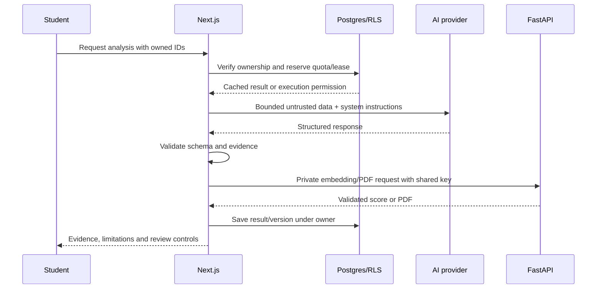

# Architecture

The browser uses Supabase public credentials only for Auth/session handling. Workspace pages call `requirePageUser`; APIs verify `auth.getUser()` and scope queries by the authenticated ID. RLS independently protects rows. New middleware coverage includes GitHub, Learning, Tailoring and all API routes.

CV versions use unique storage paths; PDF editing returns a preview and a separate save step. Company research validates public HTTPS targets and DNS addresses, pins connections, checks redirects/robots and limits page bytes/time. RAG uses owned sessions/documents/chunks and model/dimension filters. Public job feeds use fixed legitimate sources and bounded cached responses.

Independent analytics reads run in parallel with bounded snapshots and exact head-only stage counts. No AI request is made for dashboard arithmetic.

Provider calls have explicit deadlines and no automatic billable retries. Legacy analyze/match/agent endpoints use a shared Postgres quota and execution lease; identical successful inputs can reuse results for 15 minutes. Other features retain their feature-specific quotas/caches. This is not an exactly-once billing guarantee if a process crashes after a provider completes.

The private Python service permits no browser CORS origins, requires a shared key before parsing non-health requests, bounds bytes and suppresses input echoes in validation errors. CORS is not authentication; the shared key must remain server-side.
