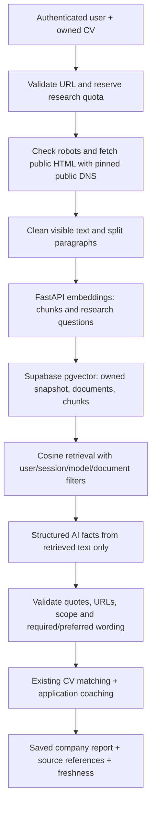

# Evidence-grounded RAG Company Intelligence

The existing Company shortlist (`/companies`) now retrieves stored semantic evidence before generating employer facts and coaching. Older reports still display. Existing company reports, CV ownership, matching, PDF suggestions, email drafts and preparation components are reused.

## Setup

1. Run **`supabase/migrations/20261028030000_company_rag.sql`** in Supabase SQL Editor. Fresh projects can run the generated `supabase/setup.sql`. This installs pgvector into the `extensions` schema, creates owned research sessions/documents/chunks and retrieval/rate-limit RPCs. If your project already installed pgvector in a different schema, adapt the migration's qualified extension references to that schema before running; do not drop an existing extension or vector data.
2. Restart FastAPI using `npm.cmd run dev:matching` and Next.js using `npm.cmd run dev` in another terminal. The new authenticated FastAPI `/embed` endpoint must be available.
3. Keep existing `MATCHING_SERVICE_URL` and `MATCHING_SERVICE_API_KEY` in `.env.local`, with the matching service key in `matching-service/.env`. Existing OpenRouter/OpenAI embedding and chat credentials/models are reused. No new key is needed; provider credits are still required.
4. Sign in, upload a text-based CV and open Company Intelligence. Supply the official employer website or a direct public job URL. A direct vacancy page gives more useful requirements than a homepage. Research can take several minutes; the existing API allows 240 seconds, so hosting must support that duration.

## Pipeline



Up to three pages are fetched per research: the submitted page and two same-origin relevant links. Readable text is capped at 16,000 characters/page, HTML at one MB/page, and the crawl at 35 seconds. Paragraphs/headings remain in order; exceptionally long paragraphs split at word boundaries. Chunks are at most 1,400 characters with a 60-chunk cap and SHA-256 content hash. Chunk/document IDs, source URL, source index/kind and fetch timestamp preserve provenance.

The FastAPI embedding batch accepts at most 64 nonempty inputs (3,000 characters each, 100,000 total), validates finite nonzero vectors, and returns provider/model identity and dimensions. Variable-dimensional pgvector columns support the existing configured models up to 3,072 dimensions. Models and vector dimensions are filtered before retrieval; vectors from different spaces are never intentionally mixed. The existing `/match` and `/rank` endpoint contracts remain unchanged.

Three query topics cover role/skills/qualifications, responsibilities/location/work-mode/salary/application instructions, and company technology/certification overview. Each topic retrieves up to three passages per document so the primary vacancy cannot be crowded out by a secondary page. Duplicate hits merge; cosine similarity below 0.2 is discarded. This threshold is a starting heuristic, not a calibrated confidence score. At most 27 passages reach generation. SQL performs exact cosine search inside a small owned snapshot, with indexed metadata filtering; no approximate vector index is needed at this scale.

Every request creates a fresh snapshot; this version does not reuse old website content or vectors across research runs. Search results are saved in existing `company_reports.result.rag`. The document/chunk tables contain public source text and vectors, **not CV text**. Existing matching/coaching still sends the owned CV to the configured provider as before. Failed indexing can leave a partial owned snapshot; it is not reused for future reports. Five research reservations/hour/user are enforced atomically, including failed attempts.

## Evidence and scope

Employer facts require an exact normalized source quote in a **retrieved chunk**, the correct source URL and the current snapshot's document/chunk IDs. Merely appearing elsewhere on a fetched page is insufficient. Returned SQL rows are checked against original chunks before generation. Existing salary, location, work-mode and certification validators still apply. Facts from different source pages cannot be combined into one vacancy's requirements. General company technologies are presented separately; vacancy qualification wording is excluded from that overview.

Required skills need explicit required/must/essential/mandatory wording. Preferred skills need preferred/optional/bonus/desirable wording. Ordinary technology mentions are not mandatory requirements. Negated requirements and ambiguous “A or B” alternatives are excluded from the mandatory skill list rather than incorrectly treating both as required. English wording heuristics can miss valid requirements in other forms/languages.

The /10 semantic match uses only explicitly required vacancy skills. If no concrete role or required skills are verified, the score is Unknown. Required/preferred CV gaps use explicit CV mentions and known synonyms; these can differ from the semantic matched/missing list, which estimates similarity. Neither means hiring probability or verified proficiency. General-company signals alone never produce a new RAG vacancy score.

Website content is untrusted data, never instructions. Generation is schema-validated, has no browsing/tools, and is instructed not to follow embedded role changes or demands. Citation validation additionally rejects recognizable prompt-injection phrases. Hidden/script/form/navigation content is removed. These defenses reduce risk; keyword filters and quotations do not establish that a publisher's statements are true or guarantee perfect semantic interpretation. User-provided URLs are not independently authenticated as employer-owned websites.

If evidence or fact extraction is insufficient, facts remain Unknown. If AI coaching fails, verified facts and a basic checklist remain available. If embedding/indexing/retrieval fails, the request reports an error instead of presenting a non-RAG report as semantic research. Coaching and learning suggestions are labelled advice, not employer promises, endorsed courses or known interview questions. Review them against cited facts and your actual CV before use.

## Publisher restrictions and network safety

Existing HTTPS-only, credential/port rejection, public-IP/DNS validation, DNS pinning, response bounds and redirect revalidation are preserved. LinkedIn/Indeed/Glassdoor scraping is explicitly unsupported. No login, paywall, CAPTCHA or anti-bot bypass is attempted.

Each origin's `/robots.txt` is checked once per research. Matching supports this crawler's agent, wildcard groups, Allow/Disallow rules, wildcard paths, terminal `$` and unreserved percent-encoding. Missing 404/410 robots files allow the normal public request; access-denied, rate-limit, network/server errors and unsupported robot redirects fail closed. Robots redirects must stay on-origin. `noai`, `nosnippet` and `noindex` page/header restrictions are conservatively honored. This is a bounded conservative crawler, not a general browser or a complete website-policy/legal parser. JavaScript-only pages, PDFs, blocked robots files and restricted publishers may remain unavailable. A skipped secondary page does not invalidate an accessible primary page; results cover only the listed sources.

## Freshness and storage

The dashboard displays source fetch times and flags evidence older than 24 hours. Re-run research after changing CV/preferences or before applying. Sources can change even within this interval; no open-vacancy guarantee is made.

Sessions, documents and chunks have user RLS plus composite ownership foreign keys; retrieval uses invoker security and explicit user/session/model/document filtering. Anonymous access and cross-user poisoning/retrieval are blocked. Old reports are compatible and show a rerun notice. Deleting an existing report removes its company-report record; research documents/chunks remain as private historical snapshots in this version. Administrators can remove old snapshots with a retention policy; account deletion cascades them. Do not delete recent rate-limit sessions merely to clear history, since they enforce the quota.

## Verification

```powershell
npm.cmd run test
npm.cmd run lint
npm.cmd run build
cd matching-service
.\.venv\Scripts\python.exe -m unittest test_matching test_hybrid test_pdf_editing test_rag
# Optional live provider call using three synthetic strings, no private CV:
.\.venv\Scripts\python.exe check_rag_embeddings.py
cd ..
# Docker Desktop required; downloads pgvector/pgvector:pg17 if absent.
node scripts/test-cv-v2-db.mjs --rag
```

Tests cover extraction/hidden text, publisher restrictions, robots rules, chunk bounds/order, embedding auth/shape/model/dimension validation, retrieved-only citation validation, cross-document role isolation, preferred-vs-required separation, insufficient evidence and prompt-injection examples. Real PostgreSQL + pgvector tests verify relevance ordering, source/model/dimension filters, RLS, cross-user document poisoning denial, anonymous denial and migration rerun. Relevance assertions use labelled synthetic vectors; they verify retrieval mechanics rather than establish general model quality. Existing CV, PDF, company and job tests remain in the suite.

Manual acceptance after applying hosted SQL:

1. Analyze a public direct vacancy link. Expand the evidence panel and check each required/preferred skill against its snippet and URL.
2. Analyze a company homepage without a vacancy. Verify general signals do not create a vacancy score; missing salary/certifications stay Unknown.
3. Try a restricted page: expect a clear error, no bypass. Stop the embedding service: expect an embedding error, no fabricated score.
4. Inspect the stored documents/chunks and new report with your own session; verify a different account cannot retrieve them.
5. Reload reports, inspect timestamps, and rerun after a CV change. Existing report/PDF editor and company preparation actions should still work.

Documentation references: [Supabase semantic search and metadata filtering](https://supabase.com/docs/guides/ai/semantic-search), [pgvector](https://github.com/pgvector/pgvector), [Robots Exclusion Protocol](https://www.rfc-editor.org/rfc/rfc9309.html).
