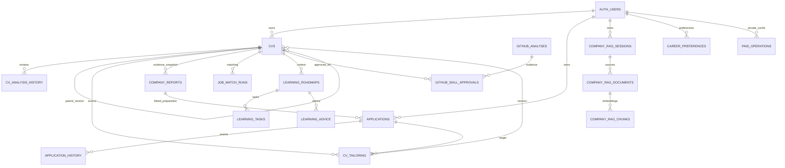

# Database relationships

The supported source of truth is `scripts/build-sql.mjs` and its generated `supabase/setup.sql`. All user-facing tables have RLS; quota tables are accessed through narrow authenticated definer functions. These functions set a restricted search path and derive ownership from `auth.uid()`.

Most ownership links to AUTH_USERS are omitted from the diagram for readability; every private row still has a user_id. Storage objects live in the private `cvs` bucket under `<user_id>/<random_uuid>.pdf`.

The production migration adds paid-operation metadata/results, RPCs, query indexes and a NOT VALID owner-path constraint. NOT VALID preserves existing legacy rows while checking new/changed rows. Run this read-only count before validating the constraint later: `select count(*) from public.cvs where file_path not like user_id::text || '/%';`. Investigate legacy rows without deleting them.

Deletion semantics vary: CV review histories cascade; newer CV versions survive with null parent references; reports may retain snapshots after source deletion; report deletion does not delete public RAG chunks. File deletion and database deletion are separate operations and cannot be one cross-service transaction. See Security for retention and recovery requirements.
