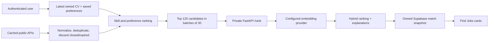

# Advanced Hybrid Semantic Job Matching

Find Jobs now loads the signed-in student's latest CV and saved career preferences automatically. No extra job-search API key is required. Existing company research, `/match`, CV review, PDF editing and application APIs keep their existing contracts.

## Setup and run

1. In Supabase SQL Editor, run `supabase/migrations/20261028010000_hybrid_job_matching.sql`. Existing projects do not need to rerun older migrations. For a fresh installation, run the generated `supabase/setup.sql` instead.
2. Keep `MATCHING_SERVICE_URL` and `MATCHING_SERVICE_API_KEY` in `.env.local`. The matching service's `.env` must have the same service key, `AI_PROVIDER=openrouter`, `OPENROUTER_API_KEY`, and optionally `OPENROUTER_EMBEDDING_MODEL=openai/text-embedding-3-small`. Never use a public-prefixed environment variable for private keys. No new credentials are needed for the feeds.
3. Restart the Python service: `npm run dev:matching`. Restart Next.js in a second terminal: `npm run dev`. On PowerShell use `npm.cmd` if script execution policy blocks `npm`.
4. Sign in, upload a text PDF in CV Profile, and visit Find Jobs (`/jobs`). Save role, multiple locations, work mode and salary preferences. Saving automatically refreshes recommendations.

## Ranking



The deterministic skill vocabulary is the existing CV skill catalogue plus aliases such as React.js/ReactJS, NodeJS, NextJS and Postgres. Headings and explicit requirement phrases separate required, preferred and ordinary mentions. Negated requirements stay unclassified. This conservative English-language heuristic is not a complete understanding of every job description: unusual headings, implicit requirements, alternatives such as “Python or Java”, and unlisted skills need human review.

Weights: required skill coverage 35%, preferred 10%, other mentions 10%, semantic relevance 30%, preference fit 15%. Skill coverage counts canonical CV skill mentions; semantic similarity never claims proof of a particular skill. FastAPI embeds CV chunks and job texts in one batch and averages CV-chunk/job cosine similarities. The first 6,000 characters of each job enter semantic matching; deterministic extraction uses up to 18,000. CV input is bounded at 50,000 characters. Preliminary ranking selects at most 120 candidates for semantic evaluation in four parallel batches of up to 30. All remaining fetched candidates remain in the ranked snapshot with skill/preference scores and explicit unavailable-semantic explanations.

Preferences average available role-term coverage, any preferred location match, explicit work-mode match and salary-range overlap. Locations use phrase boundaries; remote does not mean worldwide. Missing data and incompatible salary currencies/periods are excluded, never silently converted or treated as confirmed matches. As of hybrid-2, candidates are grouped by requirements fit before CV score: available fields match, then unknown fields, then mismatches. Mismatches are hidden by default with an explicit show-mismatches toggle. Each card lists role/title, location, work-mode and comparable salary checks. Role matching is a keyword/related-role heuristic, not an employer eligibility decision. Freeform notes are shown as unverified conditions, never assumed satisfied. Internship/trainee titles use word boundaries so International does not count as Intern.

Unavailable components redistribute their weight over known components. Component values and base weights are shown in each card. A high score supported by little evidence has limitations: this is recommendation relevance, **not hiring probability or an official ATS score**. Required gaps and preferred gaps are separate and mean “not recognized in CV”.

## Sources and freshness

| Source | Coverage and limits | Links |
| --- | --- | --- |
| Arbeitnow Europe/UK | First 100 records per public feed, mostly Europe | Source listing; employer link unknown |
| Jobicy | First 100 records for the `intern` keyword; title filter then removes unrelated non-internships; remote country restrictions remain | Required attribution and canonical Jobicy listing; direct employer link unavailable in the public feed |
| IFS / SmartRecruiters | Public `lk` and `in` feeds, first 100 postings per country and up to 15 internship/trainee/student detail requests | Source employer board and validated official application URL when supplied |

Sri Lankan/Indian coverage is a limited verified employer board, not a nationwide search. Empty regional results are valid. No LinkedIn/Indeed scraping, generated vacancies, internal postings, applications or email submissions occur. Jobicy public usage and SmartRecruiters public postings were verified against [Jobicy documentation](https://jobicy.com/jobs-rss-feed) and [SmartRecruiters endpoints](https://developers.smartrecruiters.com/reference/v1listpostings).

Normalized public feed data uses Next.js's shared cache for six hours. Normalized snapshots avoid caching oversized raw HTML; reads are bounded to four MB. Fetched timestamps belong to the cached snapshot, not the page request. Cached source records older than 24 hours are omitted with a warning if revalidation fails. Confirmed closed records and supplied expired timestamps are omitted. These current adapters generally do not publish expiry dates: “Expiry unknown” is intentional. A missing record or old publication date alone does not prove closure. Upstream closures can remain visible during the cache window; verify on the source before applying.

Deduplication uses URLs without tracking queries and normalized company/title/location. Distinct requisitions sharing all three fields may collapse. HTML is converted to plain text. API hosts are fixed, redirects forbidden, employer application links restricted to the ATS hosts. No CV/preferences enter feed requests or the public cache.

## Persistence and security

`job_match_runs` stores owned CV ID, context hash, timestamp and the recommendation snapshot (no CV body). The context hash includes CV content/skills, preferences and ranking version. Changing CV or preferences invalidates personal cached results. Complete successful snapshots are reused for one hour; degraded snapshots are saved but retried on the next request. Saved snapshots are historical, not a guarantee the job is still open. Optional user feedback is not implemented.

RLS restricts read/update to the owner and enforces owned CV references. CV deletion cascades associated snapshots. Authenticated clients cannot insert rows directly, change ownership or delete rate-history rows. An authenticated security-definer reservation checks CV ownership and serializes per-user rate counting: at most three new searches/minute and twenty/hour. Failed attempts count; cache hits do not. There is no service-role bypass in the Next.js API. Embeddings receive CV content through the existing configured provider; public sources never receive it. Embeddings do not execute uploaded instructions or call tools. Model output is bounded, validated and checked against exactly the requested job IDs.

If the migration is missing, the API provides a setup error. Provider/network failures show available skill/preference results and a warning. Source failures show other sources and warnings. Empty data is an empty state, not invented jobs. Database-save failures are reported without hiding the generated results. Snapshots currently have no automatic retention cleanup; an administrator may remove old rows after the one-hour rate window.

## Tests and evaluation

```powershell
npm.cmd run test
npm.cmd run lint
npm.cmd run build
cd matching-service
.\.venv\Scripts\python.exe -m unittest test_matching test_hybrid test_pdf_editing
cd ..
# Requires Docker Desktop; creates and removes an isolated PostgreSQL test container.
node scripts/test-cv-v2-db.mjs --hybrid
# No external calls:
node --import tsx scripts/evaluate-jobs.ts
# Requires the running matching service and provider credits; sends synthetic data only:
node --env-file=.env.local --import tsx scripts/evaluate-jobs.ts --semantic
# Public feed smoke checks, no credentials or CV data:
node --import tsx scripts/check-job-sources.ts
```

`tests/fixtures/job-ranking.json` contains three synthetic student CV profiles and eight fictional jobs. Labels 0–3 were assigned from role, skills and location fit; Recall@3 treats grades >=2 as relevant, NDCG@3 uses all graded labels with gain `2^grade-1`. The evaluation prints per-profile and macro-average metrics and exits unsuccessfully if live embeddings fail. It does not substitute fixture embeddings for live evaluation.

Verified October 28, 2026: offline baseline **Recall@3=1.000, NDCG@3=1.000**; live OpenRouter `openai/text-embedding-3-small` evaluation **Recall@3=1.000, NDCG@3=1.000**. Both ranked frontend/fullstack/design, analytics/data/backend, and backend/java/analytics respectively. This small easy dataset is a regression check, not independent real-world evidence or proof semantics improve quality. A larger separately labelled dataset is needed before tuning or claiming superiority.

Automated coverage includes synonym extraction, separate skill gaps, exact score arithmetic, multiple locations, unknown/comparable salary, deduplication, expired/closed handling, source sanitization, invalid semantic responses, FastAPI authentication/vector validation, and real PostgreSQL save/retrieve/RLS/rate-limit checks. Existing CV/PDF/company tests remain in the regression suite.

Manual checks after applying hosted SQL:

1. Upload a CV; Find Jobs shows loading, then ranked cards. Expand explanations and check skills against your CV.
2. Save two locations and Hybrid/Remote preferences. Verify ranking explanations; salary missing from a source must say unknown.
3. Reload: complete results retain their search timestamp within one hour. Save new preferences/upload a different CV: a new context is evaluated and saved.
4. Stop the matching service and change preferences: available jobs still display with a semantic warning. Restart the service and retry, respecting rate limits.
5. Check a second account cannot read the first account's `job_match_runs`. Anonymous POST `/api/jobs/search` must return 401.
6. Follow a source/official application link, verify current availability, and check existing company research, CV upload and PDF editing still work.

Hosted authenticated browser testing requires applying the migration in your Supabase project. The implementation tests do not claim that hosted migration or deployment has been performed.

## Requirements-first verification (hybrid-2)

Save requirements, wait for the automatic search, and verify the displayed role/location/work mode/salary match your saved values. A high CV score must not promote a known location/work-mode mismatch over compatible jobs. Use the mismatch toggle only to inspect alternatives. Missing salary or broad remote location stays Needs verification. Cached v1 snapshots remain readable in history, while the new context version forces a fresh search; no SQL migration is required. The feeds are a limited public pool, not a comprehensive live search of every platform. Source mistakes cannot be independently corrected without checking the linked employer listing.

## Expanded public sources (Step 28)

Sri Lankan discovery now includes the documented ITPro internship RSS feed (https://itpro.lk/rss/all/internship), with company, job title, location, descriptions and source links. ITPro explicitly permits custom dashboards: https://itpro.lk/rss/. No additional key is needed. Employer application URLs and salary remain unknown when not supplied; RSS source links are not labelled official employer links. Remote location alone does not imply worldwide eligibility. XML entity declarations and off-domain links are rejected; response sizes and fetch timeouts are bounded.

Public SmartRecruiters boards for Bosch India and LinkedIn India are added alongside IFS. LinkedIn here means vacancies at the LinkedIn company, NOT access to jobs published by all employers on linkedin.com. LinkedIn prohibits automated website scraping (https://www.linkedin.com/help/linkedin/answer/a1341543). Broad LinkedIn discovery still needs an authorized integration; this release does not implement one or claim whole-web coverage. Public Posting API reference: https://developers.smartrecruiters.com/docs/endpoints.

Sources are isolated with partial-failure warnings and six-hour public-only caches. The personal search context changes to invalidate the old single-employer result cache. No migration or credential change is required. Existing saved preferences still control ranking/hiding; more sources do not guarantee multiple matching companies for every filter. Cards now show a distinct company count. The RSS feed is a bounded recent snapshot, not an exhaustive listing archive.

Manual test: open Find Jobs and save your requirements. Verify ITPro attribution, source links, company counts and requirement explanations. Confirm restrictive locations can still return few/no matches. Use the existing mismatch toggle to inspect excluded alternatives without changing their relevance labels.

## Himalayas public API (Step 29)

Find Jobs also connects server-side to https://himalayas.app/jobs/api/search with q=intern and separate country=LK, country=IN and worldwide=true searches. Each query reads at most three 20-result pages and caches public results for six hours. It never sends CV text to the job provider. Overlapping results are deduplicated before matching. Existing title checks discard ordinary mentions of internships in senior-job descriptions. Shared public API throttling causes a source warning while other feeds remain available.

No API key or new SQL is required. API reference and display terms: https://himalayas.app/docs/remote-jobs-api. The supplied applicationLink is preserved with attribution as the card source/apply destination; it is not labelled a direct employer link. Expired entries are removed, including on personal-cache reads. Country restrictions, timezone restrictions and salary periods are retained; absent locations stay unknown, while an explicitly empty country list means worldwide according to the provider. Eligibility still needs employer verification. This is a bounded snapshot, not exhaustive platform coverage.

Remotive was investigated but not integrated: its public API terms restrict signup-gated listings, which require further review for this authenticated application (https://github.com/remotive-com/remote-jobs-api). No private API credentials were added.

Test by saving Remote preferences and a country or role in Find Jobs. Check Himalayas source attribution, expiry/unknown fields, and existing requirements-based ranking. Very restrictive preferences may still produce no results.


## Paginated discovery pipeline (Step 37)

Multiple existing public adapters normalize results to `FeedJob`. The pipeline removes duplicates and confirmed expired/closed listings, filters internship titles, ranks by CV skills and saved preferences, then applies bounded semantic reranking. A failed semantic batch preserves that batch's jobs with a partial-data warning; successful batches retain their scores. Pages browse the same snapshot without new provider, AI, or database reservation calls.

The UI shows 10 jobs per page with accessible Previous/Next buttons and page counts. Changing requirements or the mismatch toggle resets to page one. Known preference mismatches remain hidden by default, and unknown fields remain labelled. The API now retains all candidates from the bounded provider pool rather than discarding everything beyond the first 30. No SQL or new key is required. Snapshot validation allows up to 2,000 rows; current provider fetch bounds stay below that ceiling.

Himalayas pagination follows its [official API reference](https://himalayas.app/docs/remote-jobs-api). Each region requests pages 1?3; this bounded fetch is not an exhaustive crawl. Other providers retain their existing documented feed/board limits. Public caches use the v5 key; personal snapshots, including partial results, are reused for one hour to prevent repeated embedding charges. Expiry is rechecked when returning a cached snapshot. Provider listings may close before their supplied expiration time.

Manual test: start both services, sign in and open Find Jobs with a saved CV/preferences. With more than ten visible results, navigate Next/Previous and confirm no new search network request or duplicate cards. Change preferences and verify page one is selected. Toggle mismatches on a later page and verify the page resets. Stop the matching service and search with changed preferences: cards should remain with unavailable-semantic explanations and a warning. Live source availability determines the number of matches; fixtures test pagination independently of provider availability.
