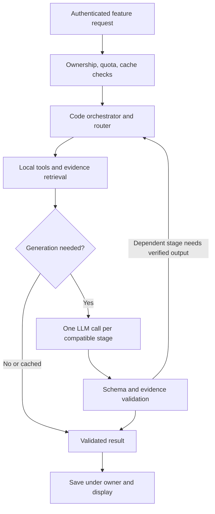

# Shared Smart Router

All active TypeScript LLM generation uses src/lib/ai/structured.ts and the stage registry src/lib/ai/router.ts. Authenticated feature endpoints select tasks; routing costs zero model calls. Unknown stages are rejected. This is explicit code routing, not a free-form chat classifier.

| Feature | Combined outputs / routing | Generation calls |
|---|---|---|
| Job analysis | Role, company, skills, responsibilities | 1 |
| Application preparation | Saved/extracted job, local CV and matching; combined bullets + email | 1 with cached job JSON, otherwise 2 |
| Company research | Local retrieval, fact extraction, citation verification, then combined CV/learning/interview/email coaching | 0-2 depending on available evidence |
| CV review | Local checks plus combined criteria/feedback/suggestions | 1 when needed |
| GitHub | Local technology evidence plus purpose/functionality/improvements | 1 per uncached selected repository |
| CV tailoring | Section order, evidence and suggestions | 1 |
| Learning roadmap | Milestones, tasks, completion criteria and resources | 1 |
| Learning next steps | Progress-based recommendations, cached by progress hash | 0-1 |
| Job ranking / tracker / analytics | Existing deterministic calculations, database reads and embeddings | 0 generation calls |

Embedding requests are separate and may still cost money. Existing feature-specific caches, quotas and fallbacks are preserved. Users/requests are never automatically batched together and private prompts are not shared across users.

Company coaching must wait for deterministic citation validation, so facts and coaching cannot safely share a call. Application drafting similarly waits for actual matching. One call per compatible stage does not mean one call for a workflow with data dependencies.

The legacy company/research-agent.ts and agent/tool-loop.ts loops remain for historical tests/compatibility but are no longer active production orchestration. Historical company traces remain readable; new ones say smart_router. Existing application tools_used labels name logical completed processing tasks, not model-issued tool calls. Final summaries are deterministic review reminders.

No new SQL or keys. Run npm.cmd run dev and npm.cmd run dev:matching. In Company Shortlist, verify the Smart router label. In Prepare my application, verify the score, three bullets and email. Other existing feature UIs and response schemas are unchanged. Tests in tests/smart-router.test.ts check one combined generation, dependencies, cached job reuse, invalid outputs and failure propagation using injected services, without paid calls. Live provider/authenticated browser acceptance remains manual.

Planner/Coder/Tester were architecture examples, not new student-facing features. Generated text is not treated as an executed test result.
